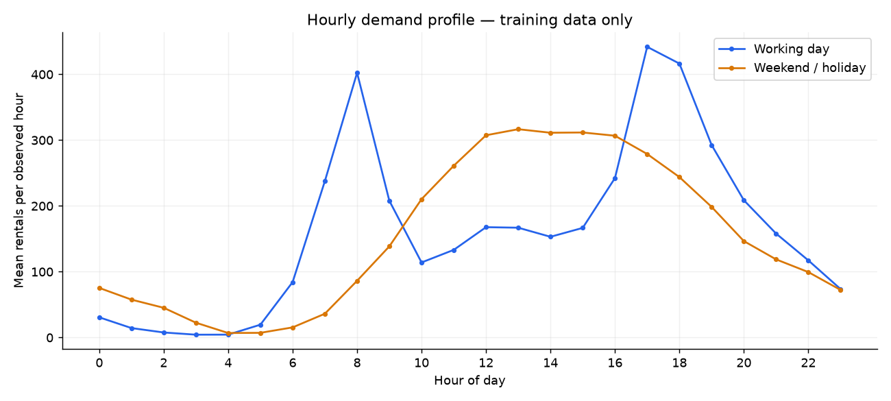

# Bike Demand ML

An end-to-end machine-learning portfolio project for exploring hourly bike-sharing demand: validated historical data, reproducible model training, temporal evaluation, and an interactive website with browser-side inference.

**[Hosted demo](https://bike-demand-zerek-lab.idealmacaw35.chatgpt.site/)** — currently owner-only through ChatGPT sign-in. For a freely accessible local demo, open [`START.html`](START.html) after cloning; no Python server or npm installation is required.

## What it does

- Estimates hourly rentals for a chosen weekday, hour, month, year, weather category, and holiday status.
- Compares the trained model with a separate historical average on an interactive chart.
- Displays validation comparisons, final-test errors, and actual-versus-predicted examples.
- Exports scenario predictions to CSV and experiment results to JSON.
- Warns about sparse weather categories and scenarios outside the training-year coverage.

This is a **historical scenario estimator**, not a validated forecast of today's demand. The data covers Washington, DC in 2011–2012 and is aggregated across the rental system, not individual stations.

## Measured results

Models were fitted on training data only and selected by validation MAE. The selected model was evaluated on the later final test without refitting on validation.

| Model | Validation MAE | Validation RMSE |
| --- | ---: | ---: |
| Hour-of-week training-average baseline | 127.5 | 169.1 |
| Ridge, one-hot encoding | 114.7 | 143.1 |
| Gradient Boosting, 150 trees / depth 3 | 74.3 | 105.6 |
| Gradient Boosting, 200 trees / depth 4 | 56.1 | 81.7 |
| **Histogram Gradient Boosting, 150 iterations / 15 leaves** | **48.1** | **74.4** |

| Final test | MAE (rentals/hour) | RMSE (rentals/hour) |
| --- | ---: | ---: |
| Selected model | **62.59** | **97.50** |
| Hour-of-week baseline | 103.19 | 149.71 |

The selected model reduced test MAE by **39.35%** relative to the baseline. This is a reduction in average error, not an accuracy percentage or a confidence interval.

Full details: [`docs/ML_EXPERIMENT.md`](docs/ML_EXPERIMENT.md) and [`reports/model_results.json`](reports/model_results.json).

## Stack and architecture

```text
UCI CSV → validation & training (Python / NumPy / Scikit-learn)
        → exported model trees → JavaScript inference → HTML/CSS interface
```

- Python 3.13, NumPy, Scikit-learn: preprocessing, training, evaluation.
- Matplotlib: exploratory charts.
- HTML, CSS, JavaScript: responsive UI and SVG charts.
- Static hosting via Sites; no inference API, GPU, Docker, or database required.

The trained trees are included in `frontend/dist/model.js`. JavaScript predictions were checked against Python over **32,256** calendar/weather combinations, with zero observed absolute difference. Export is also checked on every original feature row. The export uses version-specific Scikit-learn internals; dependencies are locked and parity must be rechecked after upgrades.

## Run the website

Clone the repository and open `START.html`, or `frontend/dist/index.html`, in your browser. Core functionality works locally; the optional Google font falls back to system fonts when offline.

For an HTTP preview using an existing Python installation:

```bash
python -m http.server 8000 --directory frontend/dist
```

Then open `http://localhost:8000`.

## Reproduce the experiment

Original data and Python environments are excluded from Git. The download script fetches the small official UCI archive and refuses to overwrite existing source files.

Windows PowerShell, from the repository root:

```powershell
python -m venv .venv
.venv\Scripts\python.exe -m pip install --no-cache-dir --only-binary=:all: -r requirements.lock.txt
.venv\Scripts\python.exe scripts\download_data.py
.venv\Scripts\python.exe scripts\inspect_data.py --csv data\raw\hour.csv
.venv\Scripts\python.exe scripts\analyze_data.py
# This explicitly reproduces the fixed experiment over the committed results.
.venv\Scripts\python.exe scripts\train_models.py --replace-results
.venv\Scripts\python.exe scripts\export_site_model.py
# Optional, requires Node.js; no npm packages needed.
node frontend\check-model.cjs artifacts\parity-fixture.json
```

On Linux/macOS use `.venv/bin/python` and forward-slash paths. Do not tune models repeatedly against the published final test; use temporal cross-validation within training data for future development.

## Data and evaluation

| Split | Date range | Observed hours |
| --- | --- | ---: |
| Training | 2011-01-01 — 2012-05-25 | 12,139 |
| Validation | 2012-05-26 — 2012-09-12 | 2,640 |
| Final test | 2012-09-13 — 2012-12-31 | 2,600 |

- Chronological splits use whole dates, without shuffling.
- `casual` and `registered` are excluded because their sum reveals the target `cnt`; row ID `instant` is excluded too.
- No missing cells or duplicate timestamps were found. There are 165 absent hours, which are not treated as zero demand.
- Historical chart averages use training data only. Their sparse-group fallback is separate from ML inference.



## Limitations

- Only one temporal holdout; seasonal and year shifts affect results.
- Training data for 2012 ends on May 25; later 2012 scenarios require extrapolation.
- Severe weather has only three training observations.
- Calendar and weather category are used; temperature, wind, and humidity are not model inputs.
- Weather is supplied by the user, not forecast by the application.
- UCI's current page and the archived README disagree on some metadata and temperature/season definitions; original codes are preserved rather than silently reinterpreted.

## Project structure

```text
scripts/        data validation, EDA, model training and export
frontend/dist/  ready-to-run static website and exported model
frontend/       JavaScript/Python inference parity check
reports/        evaluation results, provenance and figures
docs/           experiment design and learning roadmap
data/raw/       downloaded source data (ignored)
artifacts/      local trained artifacts and parity fixture (ignored)
```

## Data attribution

Fanaee-T, H. (2013). **Bike Sharing** [Dataset]. UCI Machine Learning Repository. [DOI: 10.24432/C5W894](https://doi.org/10.24432/C5W894). Dataset licensed under CC BY 4.0 according to [UCI](https://archive.ics.uci.edu/dataset/275/bike+sharing+dataset).

Associated paper: Fanaee-T, H. & Gama, J. (2013). *Event labeling combining ensemble detectors and background knowledge*. [DOI: 10.1007/s13748-013-0040-3](https://doi.org/10.1007/s13748-013-0040-3).

## Next steps

Additional training-period temporal cross-validation, newer data, and an optional FastAPI service. React, TypeScript, and FastAPI are not part of the current implementation.
